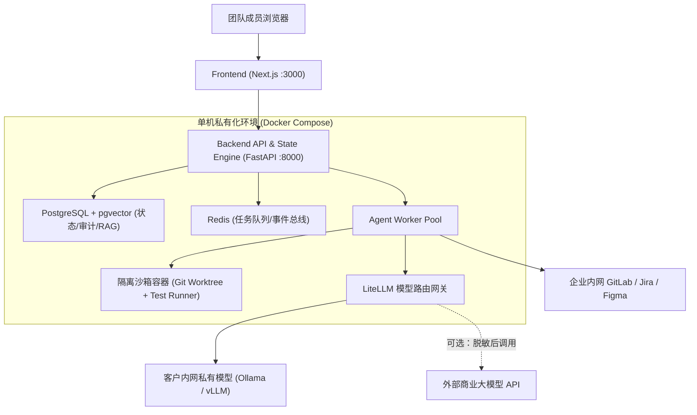

# 工程落地架构草案（Engineering Blueprint）

> [!NOTE]
> 本文档为后续正式进入研发阶段的**工程落地参考蓝图**，聚焦“单机私有化优先、B 端可配置、提案到 QA 全闭环、全链路可回退审计”的技术实现方案。

> [!WARNING]
> **实现偏差说明（2026-11-23 补记）**：本文保留为**立项时蓝图存档**。实际实现有意偏离了本文的技术栈选型——
> 未采用 Python FastAPI + LangGraph + LiteLLM + Redis/Celery，而是**纯 TypeScript 单进程**（Node 22，后端仅依赖 `yaml`），
> BYOM 网关自研（`ModelRouterGateway`），异步实时推送用进程内 EventBus + SSE 桥（无 Redis）。
> 偏差理由与最终架构见 `AGENT_ARCHITECTURE.md` 与 `BACKEND_TODO_IMPL_LOG.md`；本文其余工程原则（Worktree 沙箱 / pgvector / 审计不可变）仍有效。

---

## 一、 推荐技术栈选型（轻量、低运维、易私有化）

为了保证单机私有化交付时**依赖组件最少、客户运维成本最低**，推荐采用以下技术组合：

| 层次 | 推荐选型 | 选型理由 |
| :--- | :--- | :--- |
| **后端与编排引擎** | **Python 3.11+ (FastAPI) + LangGraph** | Python 在 AI Agent 生态最成熟；LangGraph 原生支持有环图、Checkpoint 状态持久化与 Human-in-the-loop 中断恢复。 |
| **统一模型网关 (BYOM)** | **LiteLLM** | 一套标准接口同时兼容 Ollama / vLLM 本地私有模型与 OpenAI / Anthropic / Gemini 等公有云 API，支持按节点路由与 Token 统计。 |
| **核心数据库 + 向量库** | **PostgreSQL 16 + `pgvector`** | **关键降本选型**：一套 PG 同时承担业务状态机、不可变审计日志和企业知识库向量检索，省去独立部署 Milvus/Qdrant 的运维负担。 |
| **异步任务与实时推送** | **Redis + Celery / ARQ + SSE** | 处理长耗时编码/测试任务，并通过 SSE（Server-Sent Events）向前端实时推送 Agent 协商与沙箱日志。 |
| **代码与测试沙箱** | **Git Worktree + Docker SDK** | 每次任务执行从目标仓库切出独立 Worktree，挂载进隔离容器运行单测/E2E，避免污染主干或并发冲突。 |
| **前端工作台** | **React (Next.js) + React Flow + Shadcn/UI** | React Flow 非常适合渲染“DAG 分叉回退视图”和“B 端可视化工作流编排器”。 |

---

## 二、 推荐项目目录结构（Monorepo）

```text
agentic-sdlc-os/
├── configs/
│   ├── workflows/                  # 声明式工作流模板 (B端客户可微调)
│   │   ├── fullstack_default.yaml  # 默认：提案 -> PM -> PD -> Tech -> Eng -> QA
│   │   └── backend_api_only.yaml   # 纯后端：跳过 PD 节点
│   └── risk_policies/              # 动态门禁风险评估规则
├── backend/
│   ├── app/
│   │   ├── main.py                 # FastAPI 入口与 SSE 推送
│   │   ├── engine/                 # 核心编排引擎
│   │   │   ├── dsl_loader.py       # YAML 工作流解析与动态建图
│   │   │   ├── dag_state.py        # 不可变快照与 Fork 分叉回退引擎
│   │   │   ├── risk_evaluator.py   # 业务风险评分器 (决定阻塞或自动放行)
│   │   │   └── guardrails.py       # Max Turns 熔断、Token 预算、Scope Diff 检测
│   │   ├── agents/                 # 可插拔职能 Agent 注册中心
│   │   │   ├── base.py             # 统一 Agent 契约接口 (Input/Output Schema)
│   │   │   ├── supervisor.py       # 总管 Agent (冲突汇总、自然语言回退调度)
│   │   │   ├── pm_agent.py
│   │   │   ├── pd_agent.py
│   │   │   ├── tech_lead_agent.py
│   │   │   ├── engineer_agent.py
│   │   │   └── qa_agent.py
│   │   ├── gateway/                # BYOM 模型路由与脱敏中间件
│   │   ├── context/                # Git / Figma / Jira 自动摄取与负向经验 RAG
│   │   ├── sandbox/                # Git Worktree 与 Docker 容器生命周期管理
│   │   └── audit/                  # Append-Only 审计账本服务
│   └── tests/
├── frontend/                       # Next.js 工作台 (看板 / 裁决台 / 总管指挥舱 / 审计)
└── deploy/
    ├── docker-compose.yml          # 单机私有化一键部署编排
    └── .env.example                # 模型密钥、本地 Git 路径等环境变量
```

---

## 三、 单机私有化部署拓扑

所有服务打包在同一个 `docker-compose.yml` 中，客户内网一台高配机器（或带 GPU 推理卡的服务器）即可完整拉起：



---

## 四、 核心数据模型与接口契约草案

### 4.1 数据库核心表（PostgreSQL）

1. **`workflow_runs`**（任务运行主表）
   * `id (UUID PK)`, `title`, `workflow_template_name`, `workflow_snapshot_yaml (JSONB)`（锁定本次运行时的流程配置，防止中途改配置影响旧任务）, `active_branch_id`, `token_budget`, `token_used`, `status`, `created_by`, `created_at`
2. **`stage_snapshots`**（不可变阶段快照，支撑 DAG 回退）
   * `id (UUID PK)`, `run_id (FK)`, `parent_snap_id (UUID NULL)`, `branch_id (VARCHAR)`, `stage_id`, `role_agent`, `model_used`, `artifact_json (JSONB)`（结构化交付物）, `risk_score (INT)`, `state` (`RUNNING` / `PENDING_GATE` / `APPROVED` / `REJECTED` / `SUPERSEDED`), `created_at`
3. **`negotiation_logs`**（Agent 间协商记录）
   * `id (UUID PK)`, `run_id`, `branch_id`, `from_stage`, `to_stage`, `turn_index`, `message_structured (JSONB)`, `scope_diff (JSONB)`, `is_escalated (BOOL)`, `created_at`
4. **`human_decisions`**（人类审核与自动放行决策账本）
   * `id (UUID PK)`, `snap_id (FK)`, `reviewer_id (NULLABLE)`（自动放行时为系统策略 ID）, `decision_type` (`APPROVE` / `REJECT` / `ARBITRATE` / `AUTO_PASS_LOW_RISK`), `comment`, `created_at`

### 4.2 总管 Agent 核心调度工具（Tool Calling 契约）

总管 Agent 在底层只允许调用以下 4 个受控状态机工具，严禁直接修改业务产物：

* `get_run_overview(run_id)`：获取当前各阶段状态、活跃分支与卡点摘要。
* `summarize_conflict(run_id, neg_id)`：提取达到 `Max Turns` 熔断的双方争议点，生成决策卡片。
* `rollback_and_fork(run_id, target_snap_id, instruction_for_agent)`：**核心回退工具**。将原分支后续节点置为 `SUPERSEDED`，从 `target_snap_id` 之前 Fork 出新 `branch_id`，并携带人类的新指令重新唤醒目标职能 Agent。
* `override_gate(snap_id, decision, reason)`：人工通过对话确认放行或驳回某个 Gate。

---

## 五、 后续研发实施阶段划分（参考排期）

* **Milestone 1：引擎与状态机底座（第 1–3 周）**
  * 跑通 `dsl_loader`（YAML 转状态机）、`PostgreSQL` 快照与 Fork 回退逻辑、以及 `LiteLLM` 网关接入。
* **Milestone 2：前段协商与总管调度闭环（第 4–6 周）**
  * 实现 `PM Agent` + `PD Agent` + `Supervisor Agent`，跑通 `Max Turns` 熔断、Scope Diff 检测、风险评估 Gate 及基础裁决台 UI。
* **Milestone 3：工程沙箱与 QA 闭环（第 7–10 周）**
  * 实现 `Tech Lead`、`Engineer`、`QA Agent`，打通 Git Worktree + Docker 沙箱自动跑测试与 Bug 打回修复闭环。
* **Milestone 4：审计中心与单机打包（第 11–12 周）**
  * 完善全链路不可变审计时间轴、负向经验（历史驳回库）自动注入、以及 `docker-compose` 一键私有化安装包测试。
