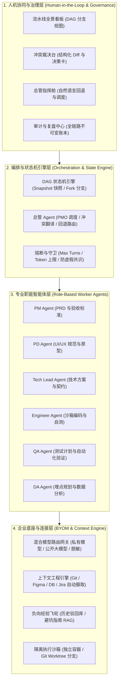
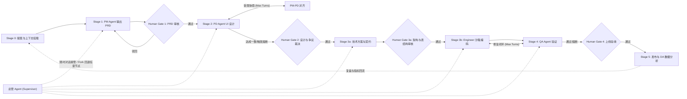

# AI 原生多智能体研发协同管理系统——完整方案设计报告

> [!NOTE]
> 本报告基于“多智能体协商 + 全流程可控状态机 + 人类交叉审核 + 总管异常接管与回退 + 全链路审计追溯”的核心理念，系统性地梳理了端到端研发工作流、潜在遗漏补全以及核心技术子系统设计。

---

## 一、 系统定位与总体架构

本系统不是一个“让多个 AI 自由聊天的对话工具”，而是一套**面向 B 端团队的可观测、可回滚、可审计的 AI 原生研发流水线操作系统（Agentic SDLC OS）**。

系统采用**四层解耦架构**：



---

## 二、 端到端核心工作流与各阶段工作内容

为了防止“下游返工成本爆炸”，系统将传统流程细化为 **6 个标准阶段（Stage 0 – Stage 5）**，并在关键节点设置 **强制人工门禁（Human Gate）** 与 **受限协商闭环（Bounded Negotiation）**。



### Stage 0：提案立项与上下文初始化（Initiation）
* **操作主体**：发起人（PM / 业务方 / 任意团队成员） + 系统上下文引擎。
* **核心工作内容**：
  1. 输入业务目标、痛点、优先级及约束条件。
  2. **自动挂载上下文**：系统根据关联的项目空间，自动拉取当前代码库摘要、设计系统（Design System）、数据库 Schema、以及**历史同类需求的驳回记录**。
  3. **初始化风控策略**：设定本次任务的 `Max Turns`（单轮协商上限，如 3 轮）、Token 预算上限、风险等级（决定哪些 Gate 必须阻塞审核）以及各环节的责任审核人（Human Owner）。

### Stage 1：PM Agent（需求分析与结构化 PRD）
* **输入**：原始提案 + 挂载的企业业务上下文 + 历史避坑知识。
* **核心工作内容**：
  1. 生成**结构化 PRD（非纯自然语言）**，必须包含：业务目标、用户故事（User Stories）、功能边界（In-Scope / Out-of-Scope）、异常边界条件、权限要求，以及可量化的**验收标准（Acceptance Criteria）**。
  2. **前置协同（容易遗漏）**：同步触发 **DA Agent** 生成初步的**《数据埋点规划（Tracking Plan）》**，确保需求阶段就定义好“上线后怎么衡量成功”。
* **Human Gate 1（人工审核）**：审核 PRD 是否遗漏核心业务规则；通过则生成不可变快照 `Snap_PRD_v1` 并进入 Stage 2。

### Stage 2：PD Agent（UI/UX 设计）与 PM-PD 协商闭环
* **输入**：`Snap_PRD_v1` + 企业 Figma 组件库/设计规范。
* **核心工作内容**：
  1. 输出界面信息架构、交互流程图、组件映射清单及可预览的前端高保真原型。
  2. **校验与反向挑战**：PD Agent 检查 PRD 是否存在交互逻辑矛盾、极端状态缺失（如空状态、超长文本、弱网加载）或超出当前组件库能力的设计。
  3. **PM-PD 受限协商机制**：
     * 若发现问题，PD Agent 向 PM Agent 发起结构化质询（最多 `N` 轮，例如 3 轮）。
     * **情况 A（协商一致）**：系统自动生成 **Scope Diff 报告**（高亮标注协商过程中是否删减或变更了原始需求），提交人工确认。
     * **情况 B（超出 Max Turns 仍未一致）**：立即触发**熔断**，由**总管 Agent** 接管，提炼双方核心分歧点，生成《冲突裁决卡》暂停流水线。
* **Human Gate 2（人工审核与裁决）**：人类审阅 UI 方案；若发生过协商变更或熔断，人类直接在裁决台拍板选定方案，生成 `Snap_Design_v1`。

### Stage 3：工程实现（拆分为 3a 技术契约 + 3b 沙箱编码）
> [!IMPORTANT]
> **关键设计修正**：不可让 Engineer Agent 拿到 PRD 和 UI 后直接一把梭写完所有代码。必须拆分为 **3a（技术设计与契约）** 和 **3b（编码实现）**，否则底层数据结构或接口设计一旦出错，整个代码分支全部作废。

* **Stage 3a：Tech Lead / 架构设计**
  * **核心工作**：基于 `Snap_PRD_v1`、`Snap_Design_v1` 与现有代码库，输出《技术设计文档（Tech Spec）》，明确 API 接口契约（OpenAPI/Protobuf）、数据库 Schema 变更（DDL）、模块依赖及影响面分析。
  * **Human Gate 3a**：专业工程师/架构师审核技术方案合理性与安全性，通过后生成 `Snap_Tech_v1`。
* **Stage 3b：Engineer Agent（隔离沙箱编码）**
  * **核心工作**：在独立的 **Git Branch / Worktree** 和容器沙箱中，严格遵循 `Snap_Tech_v1` 编写业务代码、埋点代码及单元测试，并执行本地编译与 Lint 检查。

### Stage 4：QA Agent（质量验证与缺陷闭环）
* **输入**：`Snap_PRD_v1`（验收标准） + `Snap_Design_v1` + Engineer Agent 提交的代码分支。
* **核心工作内容**：
  1. 自动生成测试计划与测试用例（覆盖正向流程、边界条件、异常输入及回归测试）。
  2. 在沙箱环境中执行自动化测试（单测、API 集成测试、UI E2E 测试）及基础安全扫描。
  3. **Engineer-QA 修复闭环**：若测试不通过，QA Agent 输出标准化的 Bug Report（含复现路径与日志）打回给 Engineer Agent 修复。同样受 `Max Turns` 和 Token 预算限制，连续修复失败超过阈值则触发熔断，上报总管 Agent。
* **Human Gate 4（上线前终审）**：人工查看测试覆盖率、自动化测试录像/报告、Code Diff，确认无误后签字放行。

### Stage 5：发布上线与 DA Agent（数据分析闭环）
* **核心工作内容**：
  1. 对接 CI/CD 触发灰度或正式发布（需人类最终触发或授权）。
  2. 上线后，**DA Agent** 自动对接企业数仓/BI 工具（基于 Stage 1 定义的 Tracking Plan），监控核心转化率、报错率与性能指标。
  3. 自动生成《阶段复盘与效果分析报告》，若指标异常或未达预期，可一键作为新提案（Stage 0）发起新一轮迭代优化。

---

## 三、 原始构想中的“六大关键遗漏”补全

在将理念转化为可落地的工程系统时，以下 6 个要素是原始设想中容易忽略、但实际运行中**不可或缺**的模块：

| 遗漏项 | 为什么必须补全？ | 本系统解决方案 |
| :--- | :--- | :--- |
| **1. 技术方案前置门禁** | 直接让 AI 写代码，一旦表结构或 API 设计不合理，下游全盘返工。 | 增加 **Stage 3a（Tech Spec Gate）**，先审接口契约与数据库变更，再写代码。 |
| **2. 埋点设计前置** | 若等到上线后才让 DA Agent 分析数据，往往发现关键行为根本没埋点。 | 在 **Stage 1（PRD 阶段）** 强制绑定 DA Agent 输出《埋点规划》。 |
| **3. 防“虚假共识”守卫** | 大模型有“讨好倾向”，PM 和 PD 为了达成一致可能悄悄砍掉核心需求绕过审核。 | 强制要求**结构化契约输出**；凡协商过程中修改/删减原始需求，必须触发 **Scope Diff 红线告警**。 |
| **4. 沙箱与分支隔离** | 多个任务并行或回退重做时，直接修改主干代码会导致环境污染与冲突。 | 每个任务分配独立的 **Docker 容器沙箱 + Git Worktree 分支**，互不干扰。 |
| **5. 外部工具双向同步** | 企业不会为了用你的系统而抛弃现有的 Jira、飞书项目、GitLab。 | 提供 Webhook 与双向同步适配器，将状态机流转实时同步回企业原有项目管理看板。 |
| **6. 审批疲劳控制** | 小改一个小按钮也要点 5 次人工确认，团队会很快放弃使用。 | 支持**分级门禁策略**：高风险变更（DB/核心逻辑）强制阻塞，低风险变更支持默认放行+事后抽检。 |

---

## 四、 核心子系统详细设计

### 4.1 总管 Agent（Supervisor）与 DAG 回退状态机

为了完美支持“通过与总管 Agent 对话，回退到任意步骤、任意职能 Agent 重做”，系统底层**不能使用线性状态覆盖**，而必须采用 **不可变快照 + DAG（有向无环图）分叉模型**。

* **总管 Agent 的严格职责边界**：
  * **允许做的**：汇总多 Agent 冲突、解析人类自然语言指令、调用状态机工具（`rollback_to_snapshot`、`fork_branch`、`assign_feedback`）。
  * **禁止做的**：总管 Agent **绝不亲自下场改 PRD 或写代码**，防止上下文污染和角色越权。
* **回退时的“脏数据”隔离机制**：
  * 假设流程已走到 Stage 4（QA），人类对总管 Agent 说：*“回退到 PD Agent，把弹窗改成侧边抽屉，然后重跑后面流程。”*
  * 状态机不会删除旧的 Stage 3/4 记录，而是从 `Snap_PRD_v1` 节点 **Fork 出一条新分支 `Branch_v2`**，将旧分支标记为 `Superseded（已废弃）`。
  * **价值**：新分支拥有绝对干净的上下文，同时旧分支的所有产出、代码和审核记录完整保留在审计库中。

### 4.2 混合模型路由网关（BYOM & Model Router）

针对 B 端客户既想用私有模型保障安全、又需要强模型保证复杂推理质量的矛盾，系统提供统一网关：
1. **多模型接入**：统一适配 OpenAI/Anthropic/Gemini 等公有云 API，以及 vLLM/Ollama 部署的企业本地私有大模型。
2. **按节点分级路由**：允许管理员配置路由策略（例如：涉及企业敏感代码与数据的摘要清洗走**本地私有模型**；涉及跨角色复杂逻辑协商与核心编码的节点走**高阶模型**，并配合敏感词/密钥自动脱敏中间件）。
3. **模型能力基线体检（Eval）**：在企业接入私有模型时，提供内置测试集校验其 JSON 遵循能力与推理稳定性，提前预警不达标的模型节点。

### 4.3 企业私有上下文工程（Context Engineering）

解决“让企业自己往壳子里填东西太痛苦”的问题，将上下文分为三层：
1. **静态规范层**：公司代码规范、安全红线、UI Design System、业务术语表。
2. **动态连接层（Zero-Effort Ingestion）**：通过 OAuth/Token 授权连接 GitLab、Figma、Confluence、数据库只读账号，系统自动构建索引并随代码提交实时增量更新。
3. **负向经验飞轮（Rejected History RAG）**：**将所有被人类驳回的方案及驳回批注自动脱敏沉淀**。当后续 Agent 遇到相似需求时，系统自动注入历史教训（例如：*“警告：历史类似需求曾因未处理并发锁被架构师驳回，请提前规避”*），使系统越用越懂该企业。

### 4.4 全链路不可变审计与追责系统（Audit Trail）

每一次流转均写入只读追加（Append-Only）的审计日志库，确保任何生产事故都可精准反向追查：

| 核心数据实体 | 关键字段设计 | 业务与审计价值 |
| :--- | :--- | :--- |
| **`WorkflowRun`** | `run_id`, `initiator_user_id`, `active_branch_id`, `token_budget`, `status` | 明确任务发起人与总资源消耗 |
| **`StageSnapshot`** | `snap_id`, `parent_snap_id`, `branch_id`, `role_agent`, `model_used`, `artifact_uri`, `state` (`Approved`/`Rejected`/`Superseded`) | 实现任意节点 Fork 回退与版本对比 |
| **`NegotiationLog`** | `neg_id`, `from_agent`, `to_agent`, `turn_index`, `conflict_summary`, `scope_diff`, `is_escalated` | 记录 Agent 间完整博弈与熔断原因 |
| **`HumanDecision`** | `decision_id`, `snap_id`, `reviewer_user_id`, `action` (`Approve`/`Reject`/`Arbitrate`), `comment`, `timestamp` | **核心追责依据**：明确哪位人员在何时批准或驳回了哪一版方案 |

---

## 五、 关键产品交互界面（UI/UX）规划

为了让“任何人都能参与”且“专业人员高效把关”，前端工作台需围绕以下四个核心视图构建：

1. **流水线全景看板（DAG Branch View）**：以树状/泳道图展示当前任务的阶段进度、各分支（`v1`/`v2`）演化历史、以及当前卡在哪个 Human Gate 等待谁审批。
2. **极简冲突裁决台（Conflict Resolution Card）**：当 Agent 协商熔断或出现 Scope Diff 时，不展示冗长聊天记录，而是呈现一张**结构化决策卡片**（展示分歧点、AI 给出的方案 A/B 对比、工期与风险评估），审核人一键点击即可裁决恢复流转。
3. **总管 Agent 指挥舱（Supervisor Console）**：悬浮或侧边常驻的全局对话窗口，支持用户随时喊停当前流水线、询问全局卡点、或用自然语言下达回退重做指令。
4. **审计与复盘时间轴（Audit Timeline）**：完整回放单个需求从提案到上线的所有快照版本、被驳回的方案对比以及责任人签核链。

---

## 六、 分阶段落地路线图（MVP 到商业化）

切忌第一天就追求“全自动接管所有岗位”，建议按以下三步走策略推进：

* **Phase 1：最小闭环 MVP（跑通核心机制）**
  * **范围**：聚焦 `Stage 0 -> Stage 1 (PM) -> Stage 2 (PD) -> Total Supervisor 回退与冲突裁决台`。
  * **目标**：验证“结构化契约生成 + 受限协商熔断 + DAG 分叉回退 + 审计账本”底层引擎的稳定性。
* **Phase 2：工程沙箱与连接器打通（进入真实研发）**
  * **范围**：接入 `Stage 3a (Tech Spec) -> Stage 3b (Engineer 沙箱编码) -> Stage 4 (QA)`，打通 GitLab/GitHub 与 Jira/飞书的双向同步，上线 BYOM 混合模型路由。
  * **目标**：在中型软件团队的内部工具或非核心业务模块中跑通真实代码交付。
* **Phase 3：企业级治理与经验飞轮（建立商业护城河）**
  * **范围**：补齐 `Stage 5 (DA 闭环)`、企业私有化部署包、RBAC 细粒度权限矩阵、以及基于历史驳回数据的“企业避坑知识库”自动沉淀。
  * **目标**：具备向中大型 B 端客户交付的商业化能力。

---

## 七、 针对最新决策的专项架构定稿（单机私有化 + 提案到 QA 闭环 + B 端可配置引擎）

根据最新明确的商业与落地策略——**“首期即覆盖提案到 QA 全流程”、“基于业务风险的动态门禁”、“优先单机私有化部署”、“支持 B 端客户流程微调”**，系统在工程实现上必须补充以下三项核心设计，否则每交付一个 B 端客户都会陷入“定制开发泥潭”。

### 7.1 声明式可配置工作流引擎（告别硬编码交付）
B 端客户对研发流程有大量个性化诉求（例如：金融客户要求在 QA 前增加“安全合规 Agent”，纯后端项目要求跳过“PD Agent”，不同客户对“最大协商轮次”和“审批人角色”要求不同）。

* **核心原则**：**工作流拓扑与 Agent 角色必须由配置文件（YAML/JSON DSL）或可视化流程编排器驱动，而非硬编码在业务代码里。**
* **可插拔机制**：
  * **节点插件化（Agent Registry）**：每个职能 Agent 封装为标准接口（输入契约 Schema + Prompt 模板 + 允许调用的沙箱工具 + 输出契约 Schema）。交付给不同客户时，可通过配置增删节点。
  * **流程模板（Workflow Templates）**：系统内置标准模板（如 `全栈研发模板`、`纯后端 API 模板`、`紧急 Bug 修复模板`），实施人员可在客户现场通过修改配置快速微调流转规则，无需重新编译发版。

```yaml
# 示例：客户可微调的声明式工作流配置片段
workflow:
  name: "enterprise_standard_sdlc"
  default_max_negotiation_turns: 3
  stages:
    - id: "pm_stage"
      agent: "PM_Agent"
      gate:
        mode: "risk_based"          # 基于业务风险动态决定是否阻塞
        high_risk_action: "block"   # 高风险强制人工审核
        low_risk_action: "auto_pass_with_audit" # 低风险自动放行并强制留痕
    - id: "pd_stage"
      agent: "PD_Agent"
      negotiate_with: ["pm_stage"]  # 允许打回与 PM 协商
      escalation_agent: "Supervisor_Agent"
    # 客户可按需插入自定义节点（如：安全审查）
    - id: "security_review"
      agent: "Security_Agent"
      enabled: true
```

### 7.2 基于业务风险的动态门禁评估器（Risk-Based Gate Evaluator）
在每个阶段产出物提交到 Gate 时，系统先由规则引擎 + 轻量模型进行**风险评分（Risk Scoring）**，在“效率”与“安全”之间取得平衡：

* **高风险特征（触发 `BLOCK`，强制人类签核）**：
  * 涉及数据库表结构（DDL）破坏性变更或核心数据迁移；
  * 涉及权限认证（RBAC）、资金/支付、外部敏感 API 对接；
  * Agent 协商过程中发生过**需求范围缩减（Scope Cut）**或**超过 Max Turns 熔断**；
  * QA 阶段发现高危安全漏洞或核心路径测试失败。
* **低风险特征（触发 `AUTO_PASS`，自动流转 + 强制留痕）**：
  * 仅涉及前端文案调整、非核心样式微调、内部文档/测试用例补充、无副作用的单元测试修复。
  * **强制审计要求**：即便自动放行，系统仍会生成完整的 `StageSnapshot` 并将 `HumanDecision` 标记为 `AutoApproved (Policy: LowRisk)`，随时支持事后抽检与通过总管 Agent 一键回退。

### 7.3 单机私有化交付架构（Single-Node On-Premise Stack）
放弃重资产的多租户云平台架构，打包为**开箱即用的单机容器套件（Docker Compose / 单节点 K3s）**，满足企业“数据绝对不出内网”的硬性要求：

1. **全栈本地化组件**：
   * **编排与服务层**：Python (FastAPI + LangGraph 状态机引擎) / Node.js 后端。
   * **数据与审计存储**：本地 **PostgreSQL**（同时开启 `pgvector` 插件兼任企业上下文向量检索，减少组件运维复杂度，一套库搞定状态机、不可变审计日志与 RAG）。
   * **隔离代码沙箱**：通过宿主机 Docker Socket 或轻量级容器池，为每个任务动态拉起独立的执行容器并挂载 **Git Worktree**，跑完即销毁或归档。
   * **本地模型直连**：默认适配客户内网的 **Ollama / vLLM / SGLang** 推理端点，同时也保留加密配置项以支持客户按需填入外部合规 API Key。
2. **首期完整闭环边界**：
   * 首期即完整交付 `Stage 0（提案） -> Stage 1（PM） -> Stage 2（PD） -> Stage 3a（Tech Spec） -> Stage 3b（Engineer 沙箱编码） -> Stage 4（QA 自动化验证）` 全链路，以及全局的 `总管 Agent 对话回退` 与 `全链路审计台`。
   * `Stage 5（DA 线上数据监控）` 作为二期扩展模块，首期仅保留 Stage 1 的埋点规划输出。
