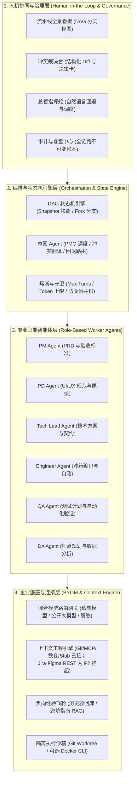
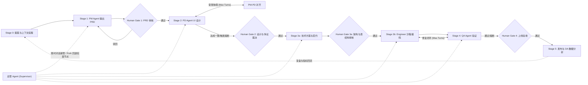

# AI 原生多智能体研发协同管理系统——完整方案设计报告

> [!NOTE]
> 本报告基于“多智能体协商 + 全流程可控状态机 + 人类交叉审核 + 总管异常接管与回退 + 全链路审计追溯”的核心理念，系统性地梳理了端到端研发工作流、潜在遗漏补全以及核心技术子系统设计。

> [!IMPORTANT]
> **当前实现状态说明（2026-11-24 更新）**：本报告概念模型与六阶段工作流均已落地，工程栈实际采用 **Node 22 + TypeScript 单进程 + React 19 / Meridian UI（`:4300`）**：
>
> - **已实现核心能力**：Stage 0–5 全流水线（含 Stage 5 DA）、DAG 分叉回退、受限协商（B1/B2）与跨模型质量/防迎合治理（DS-1~DS-4）、4 规则风险评估链、BYOM 混合路由与 A4 体检、Git Worktree / Docker CLI 沙箱、WAL/RAG 审计记忆（含 PG 驱动全量恢复）、RBAC 与会话鉴权（JSON / PG 双路径，`JsonUserStore` + `PgUserStore`）。
> - **P2 挂起项**：外部系统集成（H1 Worktree Git 上下文 / H2 Jira·飞书双向同步 / H3 Figma REST API）见 [`P2_REMAINING_PLAN.md`](./P2_REMAINING_PLAN.md)。
> - **审计进度与剩余待办**：2026-11-23 深度审计 `#1–#14` 已在第八至十四轮**全部清零**；**2026-11-24 全项目完整度复审剩余待办**（前端 React 构建恢复与登录 UI、并发锁/HTTP 安全加固、PG 双轨外键与异步化、Stage 3b 真实代码落盘、实网与 Playwright E2E 等）统一记录于 [`BACKEND_TODO.md`](./BACKEND_TODO.md) §六（历史执行明细见 [`BACKEND_TODO_IMPL_LOG.md`](./BACKEND_TODO_IMPL_LOG.md)）。

---

## 一、 系统定位与总体架构

本系统不是一个“让多个 AI 自由聊天的对话工具”，而是一套**面向 B 端团队的可观测、可回滚、可审计的 AI 原生研发流水线操作系统（Agentic SDLC OS）**。

系统采用**四层解耦架构**：



---

## 二、 端到端核心工作流与各阶段工作内容

为了防止“下游返工成本爆炸”，系统将传统流程细化为 **6 个标准阶段（Stage 0 – Stage 5）**，并在关键节点设置 **强制人工门禁（Human Gate）** 与 **受限协商闭环（Bounded Negotiation）**。



### Stage 0：提案立项与上下文初始化（Initiation）

- **操作主体**：发起人（PM / 业务方 / 任意团队成员） + 系统上下文引擎。
- **核心工作内容**：
  1. 输入业务目标、痛点、优先级及约束条件。
  2. **自动挂载上下文**：系统根据关联的项目空间，自动拉取当前代码库摘要、设计系统（Design System）、数据库 Schema、以及**历史同类需求的驳回记录**。
  3. **初始化风控策略**：设定本次任务的 `Max Turns`（单轮协商上限，如 3 轮）、Token 预算上限、风险等级（决定哪些 Gate 必须阻塞审核）以及各环节的责任审核人（Human Owner）。

### Stage 1：PM Agent（需求分析与结构化 PRD）

- **输入**：原始提案 + 挂载的企业业务上下文 + 历史避坑知识。
- **核心工作内容**：
  1. 生成**结构化 PRD（非纯自然语言）**，必须包含：业务目标、用户故事（User Stories）、功能边界（In-Scope / Out-of-Scope）、异常边界条件、权限要求，以及可量化的**验收标准（Acceptance Criteria）**。
  2. **前置协同（容易遗漏）**：由 **`ProductManagerAgent`** 在 `PrdArtifactContract` 中直接前置输出初步的**《数据埋点规划（Tracking Plan / `trackingPlanEvents`）》**，确保需求阶段就定义好“上线后怎么衡量成功”，供 Stage 5 由 `DataAnalystAgent` 核验覆盖率。
- **Human Gate 1（人工审核）**：审核 PRD 是否遗漏核心业务规则；通过则生成不可变快照 `Snap_PRD_v1` 并进入 Stage 2。

### Stage 2：PD Agent（UI/UX 设计）与 PM-PD 协商闭环

- **输入**：`Snap_PRD_v1` + 企业 Figma 组件库/设计规范。
- **核心工作内容**：
  1. 输出界面信息架构、交互流程图、组件映射清单及可预览的前端高保真原型。
  2. **校验与反向挑战**：PD Agent 检查 PRD 是否存在交互逻辑矛盾、极端状态缺失（如空状态、超长文本、弱网加载）或超出当前组件库能力的设计。
  3. **PM-PD 受限协商机制**：
     - 若发现问题，PD Agent 向 PM Agent 发起结构化质询（最多 `N` 轮，例如 3 轮）。
     - **情况 A（协商一致）**：系统自动生成 **Scope Diff 报告**（高亮标注协商过程中是否删减或变更了原始需求），提交人工确认。
     - **情况 B（超出 Max Turns 仍未一致）**：立即触发**熔断**，由**总管 Agent** 接管，提炼双方核心分歧点，生成《冲突裁决卡》暂停流水线。
- **Human Gate 2（人工审核与裁决）**：人类审阅 UI 方案；若发生过协商变更或熔断，人类直接在裁决台拍板选定方案，生成 `Snap_Design_v1`。

### Stage 3：工程实现（拆分为 3a 技术契约 + 3b 沙箱编码）

> [!IMPORTANT]
> **关键设计修正**：不可让 Engineer Agent 拿到 PRD 和 UI 后直接一把梭写完所有代码。必须拆分为 **3a（技术设计与契约）** 和 **3b（编码实现）**，否则底层数据结构或接口设计一旦出错，整个代码分支全部作废。

- **Stage 3a：Tech Lead / 架构设计**
  - **核心工作**：基于 `Snap_PRD_v1`、`Snap_Design_v1` 与现有代码库，输出《技术设计文档（Tech Spec）》，明确 API 接口契约（OpenAPI/Protobuf）、数据库 Schema 变更（DDL）、模块依赖及影响面分析。
  - **Human Gate 3a**：专业工程师/架构师审核技术方案合理性与安全性，通过后生成 `Snap_Tech_v1`。
- **Stage 3b：Engineer Agent（隔离沙箱编码）**
  - **核心工作**：在独立的 **Git Branch / Worktree** 和容器沙箱中，严格遵循 `Snap_Tech_v1` 编写业务代码、埋点代码及单元测试，并执行本地编译与 Lint 检查。

### Stage 4：QA Agent（质量验证与缺陷闭环）

- **输入**：`Snap_PRD_v1`（验收标准） + `Snap_Design_v1` + Engineer Agent 提交的代码分支。
- **核心工作内容**：
  1. 自动生成测试计划与测试用例（覆盖正向流程、边界条件、异常输入及回归测试）。
  2. 在沙箱环境中执行自动化测试（单测、API 集成测试、UI E2E 测试）及基础安全扫描。
  3. **Engineer-QA 修复闭环**：若测试不通过，QA Agent 输出标准化的 Bug Report（含复现路径与日志）打回给 Engineer Agent 修复。同样受 `Max Turns` 和 Token 预算限制，连续修复失败超过阈值则触发熔断，上报总管 Agent。
- **Human Gate 4（上线前终审）**：人工查看测试覆盖率、自动化测试录像/报告、Code Diff，确认无误后签字放行。

### Stage 5：发布上线与 DA Agent（数据分析闭环）

- **核心工作内容**：
  1. `STAGE_5_DA`（`DataAnalystAgent`）已内置于默认模板 `enterprise_sdlc.yaml`，支持基于 Stage 1 定义的 `trackingPlanEvents` 核验埋点覆盖率，并通过 `createAnalyticsProvider()` 挂载真实数仓指标（G11：`WAREHOUSE_MCP_URL` > `WAREHOUSE_CONNECTION_STRING` 只读 SQL > `WarehouseStubProvider` 确定性兜底）。
  2. _规划扩展_：对接 CI/CD 触发灰度或正式发布、上线后自动持续监控告警，以及异常指标一键回流发起 Stage 0 新提案目前保留为后续演进方向。

---

## 三、 原始构想中的“六大关键遗漏”补全

在将理念转化为可落地的工程系统时，以下 6 个要素是原始设想中容易忽略、但实际运行中**不可或缺**的模块：

| 遗漏项                  | 为什么必须补全？                                                        | 本系统解决方案                                                                                                                                                                                          |
| :---------------------- | :---------------------------------------------------------------------- | :------------------------------------------------------------------------------------------------------------------------------------------------------------------------------------------------------ |
| **1. 技术方案前置门禁** | 直接让 AI 写代码，一旦表结构或 API 设计不合理，下游全盘返工。           | 增加 **Stage 3a（Tech Spec Gate）**，先审接口契约与数据库变更，再写代码。                                                                                                                               |
| **2. 埋点设计前置**     | 若等到上线后才让 DA Agent 分析数据，往往发现关键行为根本没埋点。        | 在 **Stage 1（PRD 阶段）** 由 `ProductManagerAgent` 在 `PrdArtifactContract` 内强制前置输出《埋点规划（`trackingPlanEvents`）》，Stage 5 由 `DataAnalystAgent` 核验。                                   |
| **3. 防“虚假共识”守卫** | 大模型有“讨好倾向”，PM 和 PD 为了达成一致可能悄悄砍掉核心需求绕过审核。 | 强制要求**结构化契约输出**；凡协商过程中修改/删减原始需求，必须触发 **Scope Diff 红线告警**。                                                                                                           |
| **4. 沙箱与分支隔离**   | 多个任务并行或回退重做时，直接修改主干代码会导致环境污染与冲突。        | 每个任务分配独立的 **Git Worktree 沙箱与分支**（可选开启 `SANDBOX_RUNTIME=docker` 容器运行测试），互不干扰。                                                                                            |
| **5. 外部工具双向同步** | 企业不会为了用你的系统而抛弃现有的 Jira、飞书项目、GitLab。             | 提供可扩展上下游适配骨架；当前已实现本地 `GitContextProvider`、`McpContextProvider`、`WarehouseQueryProvider` 与确定性 Stub，Jira/飞书双向 Webhook（`H2`）规划为 P2 挂起（见 `P2_REMAINING_PLAN.md`）。 |
| **6. 审批疲劳控制**     | 小改一个小按钮也要点 5 次人工确认，团队会很快放弃使用。                 | 支持**分级门禁策略**：高风险变更（DB/核心逻辑）强制阻塞，低风险变更支持默认放行+事后抽检。                                                                                                              |

---

## 四、 核心子系统详细设计

### 4.1 总管 Agent（Supervisor）与 DAG 回退状态机

为了完美支持“通过与总管 Agent 对话，回退到任意步骤、任意职能 Agent 重做”，系统底层**不能使用线性状态覆盖**，而必须采用 **不可变快照 + DAG（有向无环图）分叉模型**。

- **总管 Agent 的严格职责边界**：
  - **允许做的**：汇总多 Agent 冲突、解析人类自然语言指令（C3）、调用 `src/agents/supervisorTools.ts` 定义的四项受控状态机工具（`get_run_overview`、`summarize_conflict`、`override_gate`、`rollback_and_fork`）。
  - **禁止做的**：总管 Agent **绝不亲自下场改 PRD 或写代码**，防止上下文污染和角色越权。
- **回退时的“脏数据”隔离机制**：
  - 假设流程已走到 Stage 4（QA），人类对总管 Agent 说：_“回退到 PD Agent，把弹窗改成侧边抽屉，然后重跑后面流程。”_
  - 状态机不会删除旧的 Stage 3/4 记录，而是从 `Snap_PRD_v1` 节点 **Fork 出一条新分支 `Branch_v2`**，将旧分支标记为 `Superseded（已废弃）`。
  - **价值**：新分支拥有绝对干净的上下文，同时旧分支的所有产出、代码和审核记录完整保留在审计库中。

### 4.2 混合模型路由网关（BYOM & Model Router）

针对 B 端客户既想用私有模型保障安全、又需要强模型保证复杂推理质量的矛盾，系统提供统一网关：

1. **多模型接入**：统一适配 OpenAI 兼容网关（含 Ollama/vLLM 本地私有部署，以及 `deploy/docker-compose.yml` 可选伴生 `litellm-router`）。
2. **按节点分级路由**：允许管理员配置路由策略（例如：涉及企业敏感代码与数据的摘要清洗走**本地私有模型**；涉及跨角色复杂逻辑协商与核心编码的节点走**高阶模型**，并配合敏感词/密钥自动脱敏中间件）。
3. **模型能力基线体检（Eval）**：在企业接入私有模型时，提供内置测试集校验其 JSON 遵循能力与推理稳定性（`ModelRouterGateway.runModelBaselineCheck` + `POST /api/admin/model-baseline`），提前预警不达标的模型节点。

### 4.3 企业私有上下文工程（Context Engineering）

解决“让企业自己往壳子里填东西太痛苦”的问题，将上下文分为三层：

1. **静态规范层**：公共工程纪律（`StagePromptSpecs`）与企业上下文预算裁剪（`ToolRegistry` / `ContextBudgetTrimmer`）。
2. **动态连接层**：当前已实现本地 `GitContextProvider`（`GIT_REPO_PATH`）、`McpContextProvider`（`FIGMA_MCP_URL`/`WAREHOUSE_MCP_URL`）、`WarehouseQueryProvider`（`WAREHOUSE_CONNECTION_STRING`）及确定性 Stub 兜底与 LLM 动态需求推断；Figma REST API 直连（`H3`）、Worktree 增量上下文（`H1`）及 OAuth/Confluence 全库索引为规划/P2 挂起能力（见 `P2_REMAINING_PLAN.md`）。
3. **负向经验飞轮（Rejected History RAG）**：**将所有被人类驳回的方案及驳回批注自动脱敏沉淀**。当后续 Agent 遇到相似需求时，系统自动注入历史教训（G2：1536 维 embedding / 离线哈希兜底），使系统越用越懂该企业。

### 4.4 全链路不可变审计与追责系统（Audit Trail）

每一次流转均写入只读追加（Append-Only）的审计日志库，确保任何生产事故都可精准反向追查（下表为概念模型，实际实现模型见 `src/domain/models.ts` 与 `deploy/init-pgvector-schema.sql` 共 **10 张表**——5 张核心流水线与向量表含 `rejected_history_rag`、`negotiation_logs`，以及 5 张用户/认证/评论表含 `team_comments`；`PgPersistenceDriver` 与 PG 全量恢复已于第十二轮 `#8` 接线，双轨 FK 列写入与 PG 缺失运行态表跟踪见 `BACKEND_TODO.md` §六）：

| 核心数据实体         | 关键字段设计                                                                                                                       | 业务与审计价值                                             |
| :------------------- | :--------------------------------------------------------------------------------------------------------------------------------- | :--------------------------------------------------------- |
| **`WorkflowRun`**    | `run_id`, `initiator_user_id`, `active_branch_id`, `token_budget`, `status`                                                        | 明确任务发起人与总资源消耗                                 |
| **`StageSnapshot`**  | `snap_id`, `parent_snap_id`, `branch_id`, `role_agent`, `model_used`, `artifact_uri`, `state` (`Approved`/`Rejected`/`Superseded`) | 实现任意节点 Fork 回退与版本对比                           |
| **`NegotiationLog`** | `neg_id`, `from_agent`, `to_agent`, `turn_index`, `conflict_summary`, `scope_diff`, `is_escalated`                                 | 记录 Agent 间完整博弈与熔断原因                            |
| **`HumanDecision`**  | `decision_id`, `snap_id`, `reviewer_user_id`, `action` (`Approve`/`Reject`/`Arbitrate`), `comment`, `timestamp`                    | **核心追责依据**：明确哪位人员在何时批准或驳回了哪一版方案 |

---

## 五、 关键产品交互界面（UI/UX）规划

为了让“任何人都能参与”且“专业人员高效把关”，前端工作台（当前已采用 React 19 + esbuild + Meridian UI 落地于 `src/ui/client/views/`，共 7 个业务视图 + `#/gallery` 组件总览页）围绕以下核心交互域构建：

1. **流水线全景看板（对应 `ProjectsHubView` / `WorkspaceView` / `DagSupervisorView`）**：展示当前任务的阶段进度、各分支演化历史、以及当前卡在哪个 Human Gate 等待谁审批。
2. **极简冲突裁决台（对应 `GateCenterView`）**：当 Agent 协商熔断或出现 Scope Diff 时呈现结构化决策卡片，审核人一键点击即可裁决恢复流转。
3. **总管 Agent 指挥舱与沙箱浏览器（对应 `DagSupervisorView` / `SandboxExplorerView`）**：支持总管自然语言下达回退指令及浏览沙箱产物与实测日志。
4. **审计复盘与治理中心（对应 `AuditRagView` / `AdminGovernanceView`）**：回放审计时间轴、负向经验检索/录入、风控阈值与模型基线体检。

---

## 六、 分阶段落地路线图（MVP 到商业化）

切忌第一天就追求“全自动接管所有岗位”，建议按以下三步走策略推进：

- **Phase 1：最小闭环 MVP（跑通核心机制）**
  - **范围**：聚焦 `Stage 0 -> Stage 1 (PM) -> Stage 2 (PD) -> Total Supervisor 回退与冲突裁决台`。
  - **目标**：验证“结构化契约生成 + 受限协商熔断 + DAG 分叉回退 + 审计账本”底层引擎的稳定性。
- **Phase 2：工程沙箱与连接器打通（进入真实研发）**
  - **范围**：接入 `Stage 3a (Tech Spec) -> Stage 3b (Engineer 沙箱编码) -> Stage 4 (QA)`，打通 GitLab/GitHub 与 Jira/飞书的双向同步，上线 BYOM 混合模型路由。
  - **目标**：在中型软件团队的内部工具或非核心业务模块中跑通真实代码交付。
- **Phase 3：企业级治理与经验飞轮（建立商业护城河）**
  - **范围**：补齐 `Stage 5 (DA 闭环)`、企业私有化部署包、RBAC 细粒度权限矩阵、以及基于历史驳回数据的“企业避坑知识库”自动沉淀。
  - **目标**：具备向中大型 B 端客户交付的商业化能力。

---

## 七、 针对最新决策的专项架构定稿（单机私有化 + 提案到 QA 闭环 + B 端可配置引擎）

根据最新明确的商业与落地策略——**“首期即覆盖提案到 QA 全流程”、“基于业务风险的动态门禁”、“优先单机私有化部署”、“支持 B 端客户流程微调”**，系统在工程实现上必须补充以下三项核心设计，否则每交付一个 B 端客户都会陷入“定制开发泥潭”。

### 7.1 声明式可配置工作流引擎（告别硬编码交付）

B 端客户对研发流程有大量个性化诉求（例如：金融客户要求在 QA 前增加“安全合规 Agent”，纯后端项目要求跳过“PD Agent”，不同客户对“最大协商轮次”和“审批人角色”要求不同）。

- **核心原则**：**工作流拓扑与 Agent 角色必须由配置文件（YAML/JSON DSL）或可视化流程编排器驱动，而非硬编码在业务代码里。**
- **可插拔机制**：
  - **节点插件化（Agent Registry）**：核心 6 个职能 Agent 均封装了输入契约、Prompt 模板、沙箱工具与输出契约校验；`src/agents/AgentRegistry.ts` 已支持在 DSL 中动态登记自定义节点（当前作为编排检查点广播通知并推进，暂不执行自定义业务体或自定义产出契约，详见 `J2_PLUGGABLE_NODES.md`）。
  - **流程模板（Workflow Templates）**：系统当前内置 2 套标准 YAML 模板——`enterprise_sdlc.yaml`（企业级全栈研发标准流水线）与 `backend_api_only.yaml`（纯后端 API 流水线）；实施人员可在 `configs/workflows/` 中按同一 DSL 规范新增或微调模板（如紧急修复模板），无需重新编译发版。

```yaml
# 示例：客户可微调的声明式工作流配置片段（Schema 对齐 WorkflowDslLoader.ts）
workflow:
  id: 'enterprise_standard_sdlc_v1'
  name: '企业级全栈研发标准流水线'
  guardrails:
    maxNegotiationTurns: 3
    maxExecutionRetries: 2
    tokenBudgetLimit: 120000
    enableSemanticCache: true
    enableFalseConsensusDiffGuard: true
    highRiskScoreThreshold: 60
  modelRouting:
    PRIVACY_SENSITIVE:
      provider: 'local-vllm'
      modelName: 'qwen2.5-coder-32b-instruct-int4'
      costPer1kTokensUsd: 0.0002
    HIGH_REASONING:
      provider: 'private-gateway'
      modelName: 'claude-3-7-sonnet-enterprise'
      costPer1kTokensUsd: 0.003
  stages:
    - stageId: 'STAGE_1_PM'
      displayName: 'Stage 1: PM 需求分析与埋点规划'
      agentRole: 'PM_AGENT'
      modelTier: 'HIGH_REASONING'
      gatePolicy:
        mode: 'RISK_BASED' # 基于业务风险动态决定是否阻塞
        lowRiskAction: 'AUTO_PASS_WITH_AUDIT'
        highRiskAction: 'BLOCK_FOR_HUMAN'
        ownerRole: '产品负责人 / 业务发起人'
    - stageId: 'STAGE_2_PD'
      displayName: 'Stage 2: PD 交互与 UI 规范设计'
      agentRole: 'PD_AGENT'
      modelTier: 'HIGH_REASONING'
      negotiateWithStageId: 'STAGE_1_PM' # 单阶段字符串引用
      escalationAgentRole: 'SUPERVISOR_AGENT'
      gatePolicy:
        mode: 'RISK_BASED'
        lowRiskAction: 'AUTO_PASS_WITH_AUDIT'
        highRiskAction: 'BLOCK_FOR_HUMAN'
        ownerRole: '体验设计负责人 / PM'
    # J2 自定义检查点节点示例（需大写下划线命名，当前按检查点通知推进）
    - stageId: 'SECURITY_REVIEW'
      displayName: '安全合规检查点'
      agentRole: 'SECURITY_AUDITOR'
      modelTier: 'HIGH_REASONING'
      enabled: true
      requiredHumanRoles: ['安全工程师', '最高管理员 (PROJECT_ADMIN)']
      gatePolicy:
        mode: 'FORCE_HUMAN_GATE'
        lowRiskAction: 'BLOCK_FOR_HUMAN'
        highRiskAction: 'BLOCK_FOR_HUMAN'
        ownerRole: '安全合规负责人'
```

### 7.2 基于业务风险的动态门禁评估器（Risk-Based Gate Evaluator）

在每个阶段产出物提交到 Gate 时，系统由**规则责任链引擎（`RiskEvaluationPipeline`；当前为纯确定性 4 规则评分，未接入轻量模型）**进行**风险评分（Risk Scoring）**，在“效率”与“安全”之间取得平衡：

- **高风险特征（触发 `BLOCK`，强制人类签核）**：
  - 涉及数据库表结构（DDL）破坏性变更或核心数据迁移；
  - 涉及权限认证（RBAC）、资金/支付、外部敏感 API 对接；
  - Agent 协商过程中发生过**需求范围缩减（Scope Cut）**或**超过 Max Turns 熔断**；
  - QA 阶段发现高危安全漏洞或核心路径测试失败。
- **低风险特征（触发 `AUTO_PASS`，自动流转 + 强制留痕）**：
  - 仅涉及前端文案调整、非核心样式微调、内部文档/测试用例补充、无副作用的单元测试修复。
  - **强制审计要求**：即便自动放行，系统仍会生成完整的 `StageSnapshot` 并将 `HumanDecision` 标记为 `AutoApproved (Policy: LowRisk)`，随时支持事后抽检与通过总管 Agent 一键回退。

### 7.3 单机私有化交付架构（Single-Node On-Premise Stack）

放弃重资产的多租户云平台架构，打包为**开箱即用的单机容器套件（`deploy/docker-compose.yml`；当前暂无 K3s 清单）**，满足企业“数据绝对不出内网”的硬性要求：

1. **全栈本地化组件**：
   - **编排与服务层**：**Node 22 + TypeScript 单进程引擎与 HTTP/SSE 工作台（`:4300`）**，以及 React 19 + esbuild + Meridian UI 静态前端产物（替代早期 FastAPI + LangGraph 构想）。
   - **数据与审计存储**：默认采用零依赖本地 JSON（`.runtime-data/`）+ 按月分片 JSONL WAL 持久化，同时可选通过 `psql` CLI 同步及恢复至本地 **PostgreSQL + `pgvector`**（`deploy/init-pgvector-schema.sql` 共 10 张表；`PgPersistenceDriver`、`PgUserStore`、容器内 `postgresql-client` 与 `LITELLM_ENABLE_LIVE_HTTP=true` 已于 `#8`/`#14` 补齐，异步优化与实网 E2E 见 `BACKEND_TODO.md` §六）。
   - **隔离代码沙箱**：基于 **Git Worktree** 隔离各任务分支工作区（porcelain 分段精确清理已于 `#11` 修复），默认宿主机运行 `node:test`，可选开启 `SANDBOX_RUNTIME=docker` 通过 Docker CLI 拉起一次性容器（已于 `#12` 改用输出重定向 + `exit $ec` 并以 `infrastructureFailure` 严格区分单测失败与引擎故障）。
   - **本地模型直连**：默认适配客户内网的 **Ollama / vLLM / SGLang** 推理端点（或 `deploy/docker-compose.yml` 伴生 `litellm-router`），同时也保留加密配置项与脱敏中间件以支持按需接入外部合规 API Key。
2. **闭环交付范围**：
   - 现行默认模板 `enterprise_sdlc.yaml` 已包含 **`Stage 0（提案） -> Stage 1（PM） -> Stage 2（PD） -> Stage 3a（Tech Spec） -> Stage 3b（Engineer 沙箱编码） -> Stage 4（QA 自动化验证） -> Stage 5（DA 埋点核验与 G11 数仓查询闭环）`** 全链路，以及全局 `总管 Agent 对话回退` 与 `全链路审计台`。
   - 与外部 **CI/CD 发布编排对接** 及 **Stage 5 异常自动一键发起 Stage 0 新提案** 作为后续演进扩展，当前 Stage 5 聚焦上线后埋点核验与指标归因分析。
