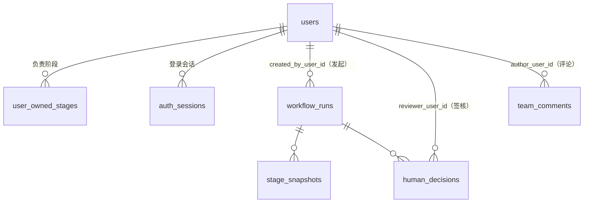

# 用户系统设计（账号 / 认证 / RBAC / API / 前端交互 / 数据库）

> [!IMPORTANT]
> 本文档是 `BACKEND_TODO.md` F1/F2 与 `BACKEND_TODO_DESIGN.md` 中"用户系统"部分的**完整设计定稿**，
> 覆盖：领域模型与数据库、认证与会话、全部 API 契约、前端交互逻辑、边界检测清单、可扩展性演进。
> 代码基线：React 前端 + `RbacGovernanceService`（权限码体系已存在但服务端未消费）+ 无认证的 `WorkbenchServer`。

> [!NOTE]
> **实现状态（2026-11-24 更新）**：
>
> - **后端 JSON 与 PG 双驱动路径（F1/F2 + 第九轮鉴权加固 + 第十二轮 AUDIT-8/D2）已落地**：`SessionService.ts`、`RbacGovernanceService.ts`、`UserStore.ts`（`JsonUserStore` + `PgUserStore` + `selectUserStore`）与 `WorkbenchServer.ts` 已实现 **10 个认证与用户管理/审计端点**（`POST /api/auth/login|logout|change-password|act-as`、`GET /api/auth/me`、`GET/POST /api/admin/users`、`PATCH /api/admin/users/:id`、`POST /api/admin/users/:id/reset-password`、`GET /api/admin/login-audit`），并配齐 §2.2 `deploy/init-pgvector-schema.sql` 用户体系 4 张表、双轨关联外键及 `team_comments`；通过 `session-service.spec.ts`（23 项）、`rbac-governance.spec.ts`（4 项）与 `pg-persistence-driver.spec.ts` Test 4–5。
> - **尚未落地部分**：前端 `LoginView.tsx` 与 Cookie/401 权限驱动界面（`src/ui/client/**` 目前仍用 `X-Actor-Id` 与硬编码角色切换条，见 `BACKEND_TODO.md` §六）。
> - **相对下述设计正文的实现差异**：① `WorkbenchServer` 采用三模式鉴权开关（`AUTH_REQUIRED=true` 全量会话校验 / 默认模式下写操作与未知 `X-Actor-Id` 严格拦截仅只读投影回落 `user-admin-01` / `AUTH_DISABLED=true` 跳过权限码校验）；② `GET /api/auth/me` 返回嵌套结构 `{ ok: true, data: { user, impersonating } }`；③ `change-password` 旧口令错与口令策略不满足均返回 `400`，管理员建人随机临时口令为 8 位 `base64url`；④ `SessionService.login()` 暂未采集 `ip`/`user_agent`，`act-as` 已写入 `loginAudit` 与 `/api/auth/me`，但尚无 `/api/auth/exit-act-as` 退出切换路径且暂未自动追加 `"via <admin>"` 到业务裁决记录展示名（见 `BACKEND_TODO.md` §六）；⑤ `EnterpriseUserAccount` 暂由 `SessionService.syncSingleUserToRbac()` 直接构造（未定义 `fromAuthUserView`）。

---

## 一、目标与范围

| 维度     | 本期（M1-C 交付）                                                                | 明确不做（留扩展点）                        |
| :------- | :------------------------------------------------------------------------------- | :------------------------------------------ |
| 认证     | 用户名/口令登录，HttpOnly Cookie 会话                                            | SSO / OIDC / LDAP（预留 AuthProvider 接口） |
| 授权     | 沿用现有两级层级（PROJECT_ADMIN / STAGE_SPECIALIST）+ 8 个权限码 + ownedStageIds | 自定义角色编辑器（预留 roles 表结构）       |
| 用户管理 | 管理员 CRUD + 启停 + 重置口令 + 阶段授权                                         | 组织架构树、部门管理                        |
| 多租户   | 单工作空间                                                                       | tenant_id 预留列设计（见 §八）              |
| MFA      | 无                                                                               | users 表预留 `mfa_secret` 列                |

**现状差距**（2026-11-22 设计前基线，其中 1/2/3 的后端部分已在 F1/F2 与第九轮解决）：

1. 无登录：`WorkbenchServer.resolveActor()` 从 `X-Actor-Id` 头/`?actorId` 读取，**未知用户静默回落 admin**（`WorkbenchServer.ts:127-144`）；
2. 花名册硬编码 7 人（`RbacGovernanceService.seedEnterpriseRoster()`），不可增删改；
3. 权限码（`SystemPermissionCode` 8 个）在 `EnterpriseUserAccount.hasPermission()` 已实现，但**服务端所有端点均未消费**；
4. 持久化中 `workflow_runs.created_by` / `human_decisions.reviewer_id` 原本是无 FK 的展示字符串（含"陈工 (PM · 资深产品经理)"这类自由文本）；第十二轮 `#8` 已在 `deploy/init-pgvector-schema.sql` 补齐 `created_by_user_id` / `reviewer_user_id` 可空 FK 列，业务 upsert 填充待续见 `BACKEND_TODO.md` §六。

---

## 二、领域模型与数据库设计

### 2.1 设计原则

1. **保留语义化 userId 作为主键**（`user-admin-01` 等）：既有审计数据、前端演示数据、`human_decisions` 已引用它们；新增用户改用 `usr_<时间戳b36>` 前缀，主键统一 `VARCHAR(64)`。
2. **业务表关联用"可空 FK 列 + 保留原展示列"双轨迁移**：`created_by_user_id` / `reviewer_user_id` 新列可空 FK 指向 users；旧 `created_by`/`reviewer_actor` 展示字符串保留（审计可读性 + 旧数据兼容）。
3. **口令永不明文/可逆存储**：`scrypt` + 每用户随机 salt，格式 `scrypt:<salt_b64>:<hash_b64>`。
4. **会话只存 token 摘要**：客户端持随机 32B token，服务端存 SHA-256 hex；泄漏库无法还原登录态。
5. **角色 = 层级 + 负责阶段集合 + 权限码集合**：全部沿用 `domain/rbac.ts` 现有枚举，不发明平行体系。

### 2.2 PostgreSQL Schema（追加到 `deploy/init-pgvector-schema.sql`，编号续接）

```sql
-- 6. 用户账号表
CREATE TABLE IF NOT EXISTS users (
    id                    VARCHAR(64) PRIMARY KEY,          -- 'user-admin-01' / 'usr_<b36>'
    username              VARCHAR(64)  NOT NULL UNIQUE,    -- 登录名，保留小写、去空格
    display_name          VARCHAR(128) NOT NULL,
    job_title             VARCHAR(128) NOT NULL,
    department            VARCHAR(128) NOT NULL DEFAULT '',
    tier                  VARCHAR(32)  NOT NULL,           -- PROJECT_ADMIN | STAGE_SPECIALIST
    specialist_domain     VARCHAR(64)  NOT NULL,           -- SpecialistDomain 枚举
    counterpart_agent_role VARCHAR(64) NOT NULL,
    avatar_badge          VARCHAR(32)  NOT NULL DEFAULT '👤',
    password_hash         VARCHAR(256) NOT NULL,           -- scrypt:<salt_b64>:<hash_b64>
    must_change_password  BOOLEAN      NOT NULL DEFAULT FALSE,   -- 首登/管理员重置后强制改密
    status                VARCHAR(16)  NOT NULL DEFAULT 'ACTIVE', -- ACTIVE | DISABLED
    failed_login_count    INT          NOT NULL DEFAULT 0,
    locked_until          TIMESTAMPTZ  NULL,               -- 连续失败锁定
    created_at            TIMESTAMPTZ  NOT NULL DEFAULT NOW(),
    updated_at            TIMESTAMPTZ  NOT NULL DEFAULT NOW()
);

-- 7. 用户负责阶段（ownedStageIds 规范化，替代 JSON 数组，便于按阶段反查责任人）
CREATE TABLE IF NOT EXISTS user_owned_stages (
    user_id  VARCHAR(64) NOT NULL REFERENCES users(id) ON DELETE CASCADE,
    stage_id VARCHAR(64) NOT NULL,
    PRIMARY KEY (user_id, stage_id)
);

-- 8. 会话表（只存 SHA-256(token)；滑动过期）
CREATE TABLE IF NOT EXISTS auth_sessions (
    token_hash      VARCHAR(64) PRIMARY KEY,
    user_id         VARCHAR(64) NOT NULL REFERENCES users(id) ON DELETE CASCADE,
    impersonated_by VARCHAR(64) NULL REFERENCES users(id),   -- 管理员"切换视角"时的真实登录者
    created_at      TIMESTAMPTZ NOT NULL DEFAULT NOW(),
    last_seen_at    TIMESTAMPTZ NOT NULL DEFAULT NOW(),
    expires_at      TIMESTAMPTZ NOT NULL,
    ip              VARCHAR(64)  NULL,
    user_agent      VARCHAR(255) NULL
);
CREATE INDEX IF NOT EXISTS idx_auth_sessions_user ON auth_sessions(user_id);

-- 9. 登录审计（追责 + 防爆破分析）
CREATE TABLE IF NOT EXISTS auth_login_audit (
    id         BIGSERIAL PRIMARY KEY,
    username   VARCHAR(64) NOT NULL,
    success    BOOLEAN     NOT NULL,
    reason     VARCHAR(64) NULL,        -- BAD_PASSWORD | LOCKED | UNKNOWN_USER | OK
    ip         VARCHAR(64)  NULL,
    created_at TIMESTAMPTZ  NOT NULL DEFAULT NOW()
);

-- 10. 既有业务表的用户关联（双轨迁移：新列可空 FK + 旧展示列保留）
ALTER TABLE workflow_runs  ADD COLUMN IF NOT EXISTS created_by_user_id  VARCHAR(64) REFERENCES users(id);
ALTER TABLE human_decisions ADD COLUMN IF NOT EXISTS reviewer_user_id    VARCHAR(64) REFERENCES users(id);
-- team_comments 已于第十二轮 #8 落地于 deploy/init-pgvector-schema.sql（表 10，含 author_user_id VARCHAR(64) REFERENCES users(id)）
```

**JSON 降级模式**（D-2 全局决策，无 DATABASE_URL 时）：`users.json` / `sessions.json` 存等价结构于 `.runtime-data/`，字段一一对应；`UserService` 以存储驱动接口屏蔽差异。

### 2.3 与既有表的关系图



要点：**用户删除 = 软删除**（`status='DISABLED'`），永不出现在 FK 级联里——审计账本（human_decisions）是追责依据，必须可解析到人。

---

## 三、认证与会话设计

### 3.1 口令策略

- 最小长度 8，需含字母+数字；`change-password` 时服务端强校验；
- 哈希：`crypto.scryptSync(password, salt, 64)`，salt 16B 随机；比对用 `timingSafeEqual`；
- 管理员"重置口令"生成随机 12 位临时口令 + `must_change_password=true`。

### 3.2 会话策略

| 项                 | 设计                                                                                                           |
| :----------------- | :------------------------------------------------------------------------------------------------------------- |
| Token              | `crypto.randomBytes(32).toString('base64url')`，仅下发客户端，服务端存 SHA-256                                 |
| 有效期             | 8h 滑动续期（每次 `validate` 刷新 `last_seen_at`/`expires_at`）                                                |
| 存储校验           | 每次请求 `validate(token)`：①token 哈希存在 ②未过期 ③**user.status=ACTIVE**（禁用即时踢出）——三条件 AND        |
| 并发会话           | 允许同用户多会话（多浏览器）；改密时**吊销该用户全部其他会话**                                                 |
| 切换视角（act-as） | 仅 admin：session 记录 `{user_id: 被视为者, impersonated_by: admin}`；所有写操作审计记录"实际操作者=via admin" |
| 锁定               | 连续失败 5 次 → `locked_until=now+60s`；成功登录清零                                                           |
| 开发/测试旁路      | `AUTH_DISABLED=true` 时跳过校验并保留旧 `X-Actor-Id` 行为（现有 19 项测试零改动）                              |

### 3.3 SessionService 代码契约

```ts
// src/server/auth/SessionService.ts
export interface AuthUserView {
  // 对外投影（永不含 password_hash）
  userId: string;
  username: string;
  displayName: string;
  jobTitle: string;
  department: string;
  tier: UserHierarchyTier;
  specialistDomain: SpecialistDomain;
  counterpartAgentRole: AgentRole;
  avatarBadge: string;
  ownedStageIds: WorkflowStageId[];
  permissions: SystemPermissionCode[];
  mustChangePassword: boolean;
  status: 'ACTIVE' | 'DISABLED';
}
export class SessionService {
  constructor(
    store: UserStore,
    opts?: { sessionTtlMs?: number; maxFailedLogins?: number; lockoutMs?: number },
  );
  login(
    username: string,
    password: string,
    meta: { ip?: string; ua?: string },
  ):
    | { ok: true; token: string; user: AuthUserView }
    | {
        ok: false;
        reason: 'BAD_PASSWORD' | 'UNKNOWN_USER' | 'LOCKED' | 'DISABLED';
        retryAfterSec?: number;
      };
  validate(token: string): AuthUserView | null; // 滑动续期 + 禁用即时失效
  logout(token: string): void;
  actAs(adminToken: string, targetUserId: string): { token: string; user: AuthUserView } | null; // admin 专属
  changePassword(userId: string, oldPwd: string, newPwd: string): { ok: boolean; reason?: string }; // 成功吊销其他会话
  resetPassword(adminUserId: string, targetUserId: string): { tempPassword: string }; // admin-only
  listUsers(): AuthUserView[];
  createUser(adminUserId: string, input: CreateUserInput): AuthUserView; // username 唯一校验 → 409
  updateUser(adminUserId: string, userId: string, patch: UpdateUserInput): AuthUserView; // 含启停（停用吊销会话）
}
```

- `UserStore` 接口：`getUserById / getUserByUsername / upsertUser / listUsers / saveSession / getSessionByHash / touchSession / deleteSession / listSessionsByUser / appendLoginAudit`，两个实现 `JsonUserStore`（默认）与 `PgUserStore`（D2 后启用）。
- 失败提示统一 `BAD_PASSWORD`（不区分"用户不存在"，防用户枚举；`UNKNOWN_USER` 只写审计）。

---

## 四、API 设计（契约层）

### 4.1 通用约定

- 认证：除 `POST /api/auth/login` 外全部要求有效会话；Cookie `sdlc_session`（HttpOnly/SameSite=Lax/Path=/），同时接受 `Authorization: Bearer <token>`（便于脚本/测试）。
- 错误信封沿用 `{ ok: false, error: string }`；状态码：**401 未认证 / 403 已认证但无权限 / 404 资源不存在 / 409 冲突（用户名重复）/ 423 已锁定 / 429 爆破限流 / 400 参数非法**。
- 权限校验从"按阶段"升级为**按端点的权限码中间件**（现状权限码未被服务端消费——本次补齐）：

```ts
// WorkbenchServer 路由守卫（伪码）
const ROUTE_PERMISSIONS: Record<string, SystemPermissionCode> = {
  'POST /api/proposals': 'CREATE_PROPOSAL',
  'POST /api/decisions': 'APPROVE_ASSIGNED_STAGE_GATE', // admin override 在 RBAC 内部判定
  'POST /api/supervisor/rollback': 'INVOKE_SUPERVISOR_ROLLBACK',
  'POST /api/sandbox/verify': 'EXECUTE_SANDBOX_VERIFICATION',
  'POST /api/admin/governance': 'MANAGE_WORKFLOW_DSL_AND_GUARDRAILS',
  '/api/admin/users*': 'MANAGE_RBAC_POLICY',
};
```

### 4.2 认证端点

| 方法/路径                        | 权限                 | 请求                         | 成功响应                                                               | 失败                                                                                                            |
| :------------------------------- | :------------------- | :--------------------------- | :--------------------------------------------------------------------- | :-------------------------------------------------------------------------------------------------------------- |
| `POST /api/auth/login`           | 匿名                 | `{username, password}`       | `200 {ok:true, data:{user: AuthUserView}}` + `Set-Cookie sdlc_session` | `401 BAD_PASSWORD/UNKNOWN_USER`（同文案"用户名或口令错误"）、`423 LOCKED`（带 `retryAfterSec`）、`403 DISABLED` |
| `POST /api/auth/logout`          | 会话                 | —                            | `200` + 清 Cookie                                                      | —                                                                                                               |
| `GET /api/auth/me`               | 会话                 | —                            | `200 {ok:true, data:AuthUserView & {impersonating?: AuthUserView}}`    | `401`                                                                                                           |
| `POST /api/auth/change-password` | 会话                 | `{oldPassword, newPassword}` | `200`（吊销其他会话）                                                  | `400 口令策略不满足`、`401 旧口令错误`                                                                          |
| `POST /api/auth/act-as`          | `MANAGE_RBAC_POLICY` | `{targetUserId}`             | `200 {data:{user}}` + 新 Cookie                                        | `403 非管理员`、`404 目标不存在/已停用`                                                                         |

### 4.3 用户管理端点（均需 `MANAGE_RBAC_POLICY`）

| 方法/路径                                     | 请求                                                                                                                                        | 响应/错误                   | 备注                                                                         |
| :-------------------------------------------- | :------------------------------------------------------------------------------------------------------------------------------------------ | :-------------------------- | :--------------------------------------------------------------------------- |
| `GET /api/admin/users`                        | —                                                                                                                                           | `{users: AuthUserView[]}`   | 停用用户也返回（带 status）                                                  |
| `POST /api/admin/users`                       | `{username, displayName, jobTitle?, department?, tier, specialistDomain, counterpartAgentRole, ownedStageIds, avatarBadge?, tempPassword?}` | `201 {data: user}`          | 409 用户名重复；stageId 未知 → 400；不传 tempPassword 则生成随机             |
| `PATCH /api/admin/users/:id`                  | `{displayName?, jobTitle?, department?, ownedStageIds?, tier?, status?}`                                                                    | `200 {data: user}`          | `status:DISABLED` → 吊销其全部会话；**禁止停用最后一个 ACTIVE admin**（409） |
| `POST /api/admin/users/:id/reset-password`    | —                                                                                                                                           | `200 {data:{tempPassword}}` | 置 `must_change_password=true`                                               |
| `GET /api/admin/login-audit?username=&limit=` | —                                                                                                                                           | 登录审计列表                | 追责/爆破分析                                                                |

### 4.4 对既有端点的鉴权补齐

| 端点                             | 现状                              | 改造                                               |
| :------------------------------- | :-------------------------------- | :------------------------------------------------- |
| `GET /api/state`                 | 匿名 + admin 兜底                 | 需会话；`rbacContext` 按 `AuthUserView` 生成       |
| `POST /api/proposals`            | 仅 `ProjectProposalContract` 校验 | +`CREATE_PROPOSAL` 权限码                          |
| `POST /api/decisions`            | `assertCanApproveStageGate`       | 保留（内部已含 admin override 判定），外加会话校验 |
| `GET /api/events/stream`         | 匿名                              | 需会话（Cookie 自动携带）；401 时不建立流          |
| 静态资源 `/`、`/styles`、`/dist` | 匿名                              | 保持匿名（登录页本身需要资源）；`/api/*` 全拦截    |

### 4.5 DashboardState 契约扩展

```ts
// RbacContextDto 增加（前端权限驱动 UI 的数据源）
readonly currentUser: AuthUserView;            // 含 permissions 与 mustChangePassword
readonly impersonating?: AuthUserView | null;   // act-as 时=真实登录者
// 前端本地派生（不新增后端字段）：
// canManageUsers = permissions.includes('MANAGE_RBAC_POLICY') 等
```

---

## 五、前端交互逻辑设计

### 5.1 会话生命周期与路由守卫

```
App 初始化
  ├─ GET /api/auth/me ──200──▶ 进入工作台（现有流程）
  ├─        └──401──────────▶ 渲染 <LoginView/>（登录页，替换工作台）
  └─ SSE 401 ───────────────▶ 清本地状态 → 渲染 LoginView + banner"会话已过期，请重新登录"
```

- `WorkbenchApiClient` 增加 401 统一拦截：任何 API 返回 401 → `onSessionExpired()` 回调 → App 切登录态（**不自动登出**：避免管理员 act-as 会话被误清）。
- `mustChangePassword=true` → 登录后强制渲染改密表单，改密成功前所有视图禁用。

### 5.2 登录页（新组件 `views/LoginView.tsx`）

- 品牌 + 用户名/口令 + 登录按钮；错误文案统一"用户名或口令错误"（防枚举）；`423` 显示"已锁定，Xs 后重试"倒计时；`DISABLED` 显示"账号已停用，请联系管理员"。
- 登录成功 → `refreshState()` + 重连 SSE → 进入 `#/workspace`。

### 5.3 成员视角切换的演变（现"角色胶囊"的替代）

| 现状                                                   | 设计后                                                                                                                                                                                                                                                                              |
| :----------------------------------------------------- | :---------------------------------------------------------------------------------------------------------------------------------------------------------------------------------------------------------------------------------------------------------------------------------- |
| 6 个硬编码胶囊，任意用户可切换任意身份（纯前端假切换） | **普通成员**：无切换入口，只能以本人身份操作；**管理员**：胶囊条保留但变为"管理员视角切换"——点击弹出花名册下拉（来自 `rbacContext.roster`，仅 ACTIVE），选择后调 `POST /api/auth/act-as` 换发会话；顶栏常驻黄色 pill `👁️ 正在以 林工 视角操作（真实身份 王总管）`，一键"返回本人"。 |
| 切换无痕迹                                             | 每次 act-as 写入 `auth_login_audit`（reason=ACT_AS）+ 业务审计所有写操作 reviewer/author 同时记录"被操作者 user_id + via admin"                                                                                                                                                     |

### 5.4 权限驱动 UI（消费 `currentUser.permissions`）

| UI 元素                        | 控制权限码                                                | 无权限时的表现                 |
| :----------------------------- | :-------------------------------------------------------- | :----------------------------- |
| `+ 发起新项目` / 预设按钮      | `CREATE_PROPOSAL`                                         | 隐藏按钮                       |
| 阶段操作台裁决按钮             | `APPROVE_ASSIGNED_STAGE_GATE`（+admin override 现有逻辑） | 保持现状：🔒 灰置 + 责任人提示 |
| 发送回退指令按钮               | `INVOKE_SUPERVISOR_ROLLBACK`                              | 隐藏                           |
| 沙箱"运行单测"按钮             | `EXECUTE_SANDBOX_VERIFICATION`                            | 隐藏                           |
| 治理页保存按钮 / 模板切换      | `MANAGE_WORKFLOW_DSL_AND_GUARDRAILS`                      | 🔒 灰置（现状语义保留）        |
| 团队成员页"新增成员/编辑/停用" | `MANAGE_RBAC_POLICY`                                      | 普通成员看不到管理区           |

### 5.5 个人菜单（新组件，顶栏头像下拉）

- 显示 `AuthUserView` 摘要；操作：`修改密码`（弹抽屉：旧口令+新口令+确认，成功提示"其他设备已退出登录"）、`退出登录`（logout → LoginView）；
- act-as 会话额外显示"返回本人身份"。

### 5.6 管理端新增 UI（挂载在现有 `admin-governance` 视图）

- 花名册表每行增加 `编辑 / 重置口令 / 停用·启用` 操作（抽屉表单，复用 DetailDrawer）；
- 新增成员表单（字段对齐 4.3 POST body，ownedStageIds 用 6 阶段多选 chips）；
- 登录审计最近 20 条折叠列表。

---

## 六、边界检测清单（设计自验）

### 6.1 登录与口令

| #   | 边界                                      | 处理                                                                  |
| :-- | :---------------------------------------- | :-------------------------------------------------------------------- |
| 1   | 用户名不存在 vs 口令错误                  | 统一返回"用户名或口令错误"；`UNKNOWN_USER` 只入审计（防枚举）         |
| 2   | 连续失败 5 次                             | `locked_until=now+60s`；期间即使口令正确也 423；成功登录清零          |
| 3   | 用户名前后空格 / 大小写                   | 登录名 `trim()` + 转小写比对；注册时禁止大小写仅差异的重名            |
| 4   | 口令含 Unicode/空格                       | 允许（仅校验长度与字符类别），scrypt 按 UTF-8 字节处理                |
| 5   | 并发爆破                                  | 423 + `auth_login_audit` 记录 ip；单机部署不做全局 IP 限流（P2 记录） |
| 6   | 旧口令与新口令相同                        | 拒绝（400）                                                           |
| 7   | `must_change_password` 未改密就调业务 API | 中间件拦截：除 auth/me、change-password 外一律 403                    |

### 6.2 会话

| #   | 边界                      | 处理                                                                             |
| :-- | :------------------------ | :------------------------------------------------------------------------------- |
| 8   | 会话过期发生在请求中途    | 该请求正常完成（进入时已校验）；下一请求 401 → 前端切登录页                      |
| 9   | SSE 长连接中会话过期      | 流保持（已建立），`state_updated` 下一帧前若 401 则断流；客户端 401 拦截兜底     |
| 10  | 服务器重启                | PG 模式会话持久化可恢复；JSON 模式会话丢失 → 用户重新登录（可接受，文档化）      |
| 11  | 被停用用户持有效会话      | 每次 `validate` 查 user.status → 立即 401（不等过期）                            |
| 12  | 改密后其他浏览器          | 吊销该用户除当前会话外全部会话                                                   |
| 13  | act-as 会话与本人会话并存 | 两个独立 token；act-as 会话 `impersonated_by` 标记；退出 act-as = 仅吊销该 token |
| 14  | Cookie 伪造/猜解          | 服务端只存 SHA-256(token)，32B 随机不可猜；`timingSafeEqual` 比对                |
| 15  | 多标签页同时操作          | 会话共享（Cookie），无冲突；审计按操作时间序记录                                 |

### 6.3 用户管理

| #   | 边界                                        | 处理                                                                        |
| :-- | :------------------------------------------ | :-------------------------------------------------------------------------- |
| 16  | 删除/停用有历史 run 的用户                  | 仅软停用；`created_by_user_id` FK 保留（不做物理删除）                      |
| 17  | 停用最后一个 ACTIVE 管理员                  | 409 + 明确错误文案                                                          |
| 18  | 修改某成员 ownedStageIds 时其阶段正 PENDING | 已产生的待办通知不回收（历史事实）；**新**裁决按新权限判定（validate 实时） |
| 19  | 用户名重复                                  | 409 + `字段: username`                                                      |
| 20  | admin 修改自己的 tier 为 STAGE_SPECIALIST   | 允许，但若导致"无 ACTIVE admin"则 409（同 #17）                             |
| 21  | 重置口令后原会话                            | 全部吊销，仅下发临时口令 + must_change_password                             |
| 22  | act-as 目标被停用                           | 404/403，act-as 拒绝；已建立的 act-as 会话在目标停用后随 #11 即时失效       |

### 6.4 数据与迁移

| #   | 边界                                                               | 处理                                                                                                     |
| :-- | :----------------------------------------------------------------- | :------------------------------------------------------------------------------------------------------- |
| 23  | 旧数据 `reviewer_actor` 是自由文本（如"陈工 (PM · 资深产品经理)"） | 迁移脚本按花名册 displayName 模糊匹配回填 `reviewer_user_id`；匹配不到保持 NULL + 展示列原样（审计不丢） |
| 24  | JSON 与 PG 双模式并存                                              | UserStore 接口屏蔽；切换驱动时执行一次性 users 迁移脚本                                                  |
| 25  | AUTH_DISABLED=true 时权限码校验                                    | 跳过（演示/测试），但所有响应仍带完整 rbacContext（前端表现一致）                                        |

---

## 七、可扩展性设计

| 演进方向               | 预留点                                                                                                                                                 | 改造成本                                                                                                                                                      |
| :--------------------- | :----------------------------------------------------------------------------------------------------------------------------------------------------- | :------------------------------------------------------------------------------------------------------------------------------------------------------------ |
| **SSO / OIDC / LDAP**  | `AuthProvider` 接口：`{kind:'password'                                                                                                                 | 'oidc', authenticate(credentials): Promise<AuthUserView>}`；SessionService 只依赖该接口，OIDC 时登录页跳转授权码流程、回调换 token 后**会话签发逻辑完全复用** | 低  |
| **自定义角色**         | 新增 `roles(id, name, permissions JSONB)` + `user_roles` 映射；`EnterpriseUserAccount.permissions` 改为"层级默认码 ∪ 角色码"合并；无-role 用户行为不变 | 中                                                                                                                                                            |
| **多租户**             | `users.tenant_id`、`workflow_runs.tenant_id` 预留列；所有列表查询带 tenant 过滤；单机版固定 `tenant_id='default'`                                      | 中（需全表迁移）                                                                                                                                              |
| **MFA (TOTP)**         | `users.mfa_secret` 列预留；登录成功且启用 MFA → 401 附 `{mfaRequired:true}` → 前端第二步表单                                                           | 低                                                                                                                                                            |
| **细粒度操作审计查询** | `auth_login_audit` + 业务 `human_decisions` 已具备；可加统一 `audit_events` 视图                                                                       | 低                                                                                                                                                            |

---

## 八、代码改造点映射

| 文件                                                     | 改动                                                                                  |
| :------------------------------------------------------- | :------------------------------------------------------------------------------------ |
| 新增 `src/server/auth/SessionService.ts`                 | §3.3 全部逻辑（口令/会话/act-as/用户管理）                                            |
| 新增 `src/server/auth/UserStore.ts` + `JsonUserStore.ts` | 存储驱动接口与 JSON 实现（PG 版随 D2）                                                |
| 改 `src/server/WorkbenchServer.ts`                       | 登录端点、ROUTE_PERMISSIONS 中间件、resolveActor 重写（401/403）、Cookie 解析         |
| 改 `src/engine/RbacGovernanceService.ts`                 | 移除 seed 硬编码与 admin 兜底 → 从 UserStore 读取；`getUserStrict`                    |
| 改 `src/domain/rbac.ts`                                  | `EnterpriseUserAccount` 增加 `fromAuthUserView/toSerializableRecord` 对齐；无字段删除 |
| 改 `deploy/init-pgvector-schema.sql`                     | 追加 §2.2 的 4 张表 + 2 个 ALTER                                                      |
| 新增前端 `views/LoginView.tsx`                           | 登录/改密表单                                                                         |
| 改前端 `App.tsx`                                         | 会话初始化（/me）、401 拦截、登录态切换、权限驱动渲染                                 |
| 改前端 `components/Topbar.tsx`                           | 角色胶囊 → 管理员视角切换 + 个人菜单                                                  |
| 改前端 `WorkbenchApiClient.ts`                           | Cookie 凭证（`credentials:'include'`）、401 回调                                      |
| 改前端 `views/AdminGovernanceView.tsx`                   | 用户管理操作区                                                                        |

---

## 九、验收测试清单

1. **认证流**：未登录访问 `/api/state` → 401；登录 → Set-Cookie → `/api/auth/me` 返回本人；错误口令 ×5 → 423；改密 → 旧会话失效、新口令生效。
2. **权限流**：林工(PD) 登录 → `POST /api/decisions` 对 STAGE_3A 快照 → 403 且审计无记录；王总管 → 200 且 `human_decisions.reviewer_user_id` 正确。
3. **act-as**：admin act-as 林工 → 响应含 `impersonating`；裁决记录 `reviewer_actor` 含"via 王总管"；审计 login_audit 有 ACT_AS。
4. **用户管理**：创建重名 → 409；停用 → 该用户会话立即 401；停用最后 admin → 409。
5. **前端**：401 自动切登录页；`must_change_password` 强制改密；权限码隐藏对应按钮；act-as 黄色提示条 + 返回本人。
6. **兼容**：`AUTH_DISABLED=true` 时现有 19 项测试与浏览器演示流零改动通过。
7. **迁移**：PG 模式下旧 `reviewer_actor` 文本按花名册回填 FK 的比例 ≥ 已知可匹配集合；未匹配行保持 NULL 且展示列不变。
